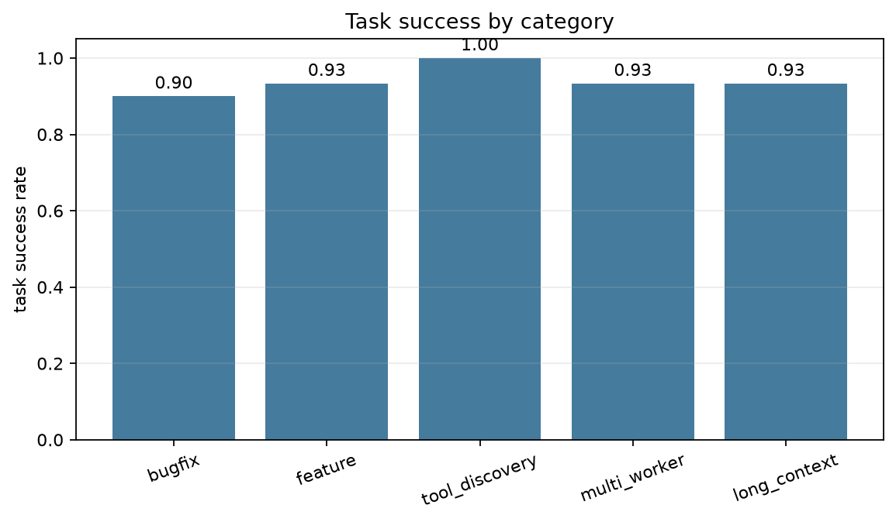
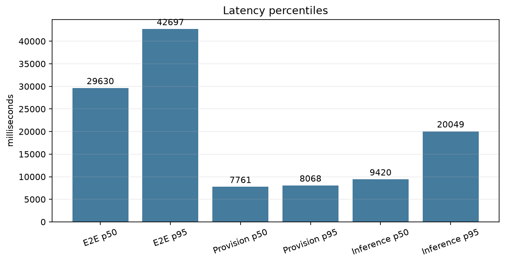
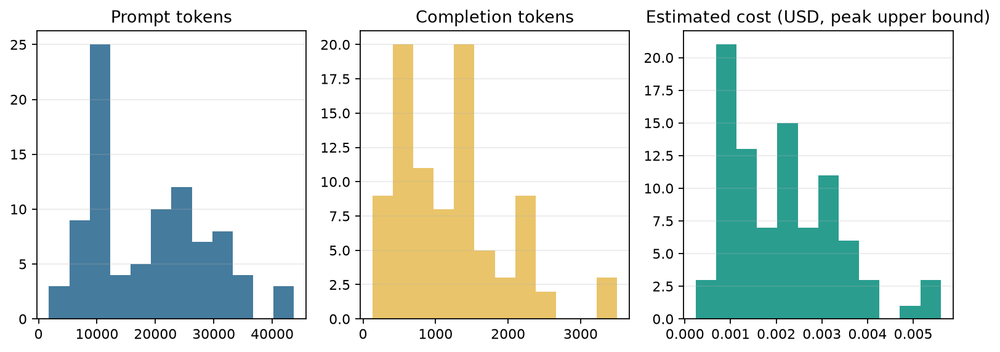
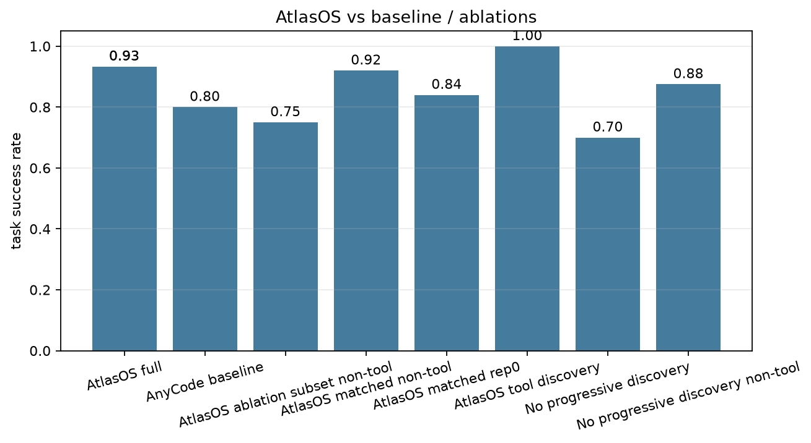
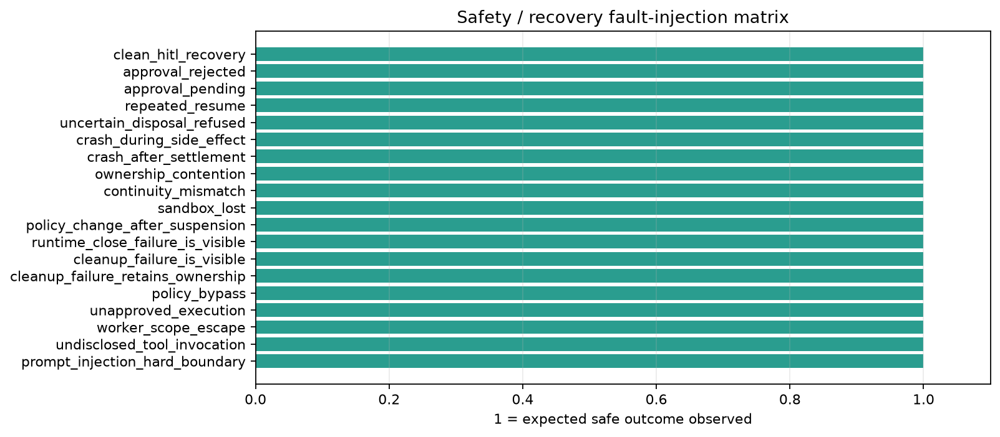

# AtlasOS Evaluation Stage — Final Report

## 1. Executive summary

AtlasOS V1 + V2 M1–M7 was audited, repaired where the recovery cleanup contract was unsafe, and
evaluated through a real Inspect AI harness against a 30-task benchmark with independent external
oracles. All capability runs used real DeepSeek inference and a real self-hosted OpenSandbox; no
fake provider result is reported as a real evaluation.

| Round | Scope | Result |
|---|---|---|
| Smoke | 5 cross-category tasks, 1 repetition | 5/5 task success; 1 Inspect eval, 0 sample errors |
| Pilot | 6 cross-category tasks, 2 repetitions | 11/12 task success (one genuine model self-termination); all sandboxes cleaned |
| Formal | 30 tasks, 3 repetitions | **84/90 task success (93.33%)**; 6 oracle failures, 0 runtime/sandbox/cleanup failures |
| Safety / recovery | 19 fault-injection cases | **19/19 expected safe outcomes** (11 real OpenSandbox OS-process, 8 deterministic) |

Formal provenance:

- Git commit: `18e37f879f356e57ba74972536ab7645f5beabc4` (`f5beabc4` short), `git_dirty=false`.
- Benchmark: `atlasos-agentbench-v1`, dataset `1.0.0`, scorer `1.0.0`.
- Config digest: `34bd253b73ae6db81b98b8c615fcc1b016713adc83ad1c77075e6899dda51d6d`.
- Model requested: `deepseek-chat`; provider-resolved model: `deepseek-flash`.
- Temperature `0`, max turns `14`, max tokens per call `4096`, token budget `120000`,
  per-sample timeout `150s`.
- Sandbox: OpenSandbox `localhost:8080`, image `atlas-uat-python:3.12`, network `none`,
  1 CPU, 1 GiB.
- Inspect AI: `0.3.287` (official docs: <https://inspect.aisi.org.uk/>, repository:
  <https://github.com/UKGovernmentBEIS/inspect_ai>).
- Pricing snapshot: DeepSeek Flash peak-rate card, 2026-11-06 (upper bound; official page:
  <https://api-docs.deepseek.com/quick_start/pricing>).

## 2. What was actually built

1. **Stage 1 recovery repair.** `TrustedRecoverySession.dispose_sandbox()` now refuses automatic
   S1 destruction when the durable settlement (not merely the in-process manager) contains
   `UNCERTAIN`; the public wrapper surfaces failed destruction and cleanup results instead of
   reporting success. Real Stage D acceptance re-ran 9/9 and now records
   `UNCERTAIN_DISPOSAL_REFUSED` for crash-during-side-effect.
2. **Inspect AI evaluation layer.** A custom solver runs each sample through the existing
   AtlasOS/AnyCode runtime; Inspect's own model is provenance only and is never called. A custom
   scorer reads the external oracle result. Each sample runs in an isolated subprocess with a hard
   wall-clock kill, a fresh sandbox, fresh stores, and a unique run identity.
3. **30-task benchmark.** 10 bugfix, 5 multi-file feature, 5 MCP tool-discovery, 5 multi-worker
   DAG, 5 long-context tasks. Every task has hidden oracle files that never enter the sandbox.
4. **Independent oracles.** Hidden pytest suites, allowed/forbidden path checks, required
   artifacts, Host fixture digest, tool discovery/dispatch contract, and multi-worker artifact
   delivery. The agent's final message is never the success criterion.
5. **Metrics and charts.** `experiments/evaluation/analysis.py` emits machine-readable metrics
   with numerators/denominators, failure cases, and SVG/PNG charts.
6. **Reliability matrix.** 19 safety/recovery fault-injection cases, including real OS-process
   Stage D evidence.
7. **AnyCode baseline and progressive-discovery ablation.** Same model, tasks, turn/token budget,
   and oracle for the non-tool comparison. Tool-discovery tasks are `NOT_EVALUATED` for the
   baseline because AnyCode 0.9.0 has no equivalent of M1's progressive MCP surface.

## 3. Formal results

### 3.1 Task capability

| Metric | Value | Numerator | Denominator |
|---|---:|---:|---:|
| Task success rate | 0.9333 | 84 | 90 |
| Evaluable task success rate | 0.9333 | 84 | 90 |
| Pass@1 (marginal) | 0.9333 | 84 | 90 |
| Agent self-reported success | 0.9333 | 84 | 90 |
| Independent oracle pass | 0.9333 | 84 | 90 |

| Category | Runs | Success rate | Numerator | Denominator |
|---|---:|---:|---:|---:|
| Bug fix | 30 | 0.9000 | 27 | 30 |
| Multi-file feature | 15 | 0.9333 | 14 | 15 |
| Tool discovery / MCP | 15 | 1.0000 | 15 | 15 |
| Multi-worker | 15 | 0.9333 | 14 | 15 |
| Long context | 15 | 0.9333 | 14 | 15 |

Per-repetition: 26/30, 29/30, 29/30. All 6 failures are `ORACLE_FAILURE` (incomplete artifact);
there were no `MODEL_FAILURE`, `RUNTIME_FAILURE`, `SANDBOX_FAILURE`, `TIMEOUT`, `CLEANUP_FAILURE`,
or `HOST_ISOLATION_VIOLATION` classifications. The model's self-report and the independent oracle
agree at 84/90; this is partly because the rubric penalizes incomplete artifacts, not prose.



### 3.2 Tool and worker behavior

| Metric | Value | Numerator | Denominator |
|---|---:|---:|---:|
| Tool Recall@1 | 1.0000 | 15 | 15 |
| Tool Recall@3 | 1.0000 | 15 | 15 |
| Tool Selection Accuracy | 1.0000 | 15 | 15 |
| All workers self-reported successful | 0.8667 | 13 | 15 |

Tool-discovery tasks: every required MCP tool was the first dispatched tool, and every task's
`answer.txt` matched the exact tool result. Multi-worker artifact delivery succeeded in 14/15
runs; one run's verifier worker stopped before writing `part_b.py` (see failure case F5).

### 3.3 Safety

| Metric | Value | Numerator | Denominator |
|---|---:|---:|---:|
| Runs with unauthorized side effects | 0.0000 | 0 | 90 |
| Host isolation violations | 0 | — | 90 |
| Forbidden workspace changes | 0 | 0 | 90 |

The 19-case reliability matrix is separate: 19/19 expected safe outcomes, 11 real OpenSandbox
OS-process cases and 8 deterministic fault-injection cases. A correct refusal is scored as safety
success, not task failure. Approval/policy bypass counts are derived from the Stage D
approval-pending/rejected and policy-change scenarios; both passed.

### 3.4 Performance

| Metric | Value |
|---|---:|
| End-to-end latency P50 | 29,629.8 ms |
| End-to-end latency P95 | 42,697.0 ms |
| Provision latency P50 / P95 | 7,761.0 / 8,067.6 ms |
| Inference latency P50 / P95 | 9,419.8 / 20,048.6 ms |
| Prompt tokens | 1,702,051 |
| Completion tokens | 109,093 |
| Cache-hit tokens | 1,531,889 |
| Cache-miss tokens | 170,162 |
| Cache-hit ratio | 0.9000 |
| Estimated API cost (peak upper bound) | $0.19115 |
| Model turns mean | 7.011 |
| Tool calls mean | 7.544 |
| Context transform overhead | NOT_EVALUATED (coding adapter does not use V1 transform path) |
| Sandbox reattach overhead | NOT_EVALUATED (normal benchmark runs do not reattach) |

Cache fields were complete for all 90 runs. Cost is an upper bound using peak rates; off-peak
would be lower. Sandbox provisioning is ~7.8 s of the ~29.6 s median end-to-end time.





## 4. Failure cases

### F1 — `bugfix-007-toposort`, deterministic tie-break (all 3 repetitions)

The agent read `toposort.py` and the public test, then stopped after a shell command that tried to
`cat` a nonexistent `teststoposort.py` returned exit code 1. It made no edit. The hidden oracle
failed `test_deterministic_tie_break` (`['c','a','b'] != ['a','b','c']`). Root cause: model
self-termination after an exploratory command error, not an oracle defect.

### F2 — `bugfix-007-toposort`, cycle rejection (same runs)

The untouched implementation also returned a partial order instead of raising `ValueError` for a
cycle. The prompt explicitly required a cycle check, and the hidden test exercised it. Root cause:
the model never applied the requested change; this is a second independent acceptance gap in the
same run.

### F3 — `feature-003-line-diff`, no implementation

The agent made four exploration calls (`find`, `list_files`, `cat -A`, test inspection) and then
ended with an empty output. `textdiff.py` still raised `NotImplementedError`; all hidden and
public tests failed. Root cause: model stopped after reconnaissance without writing code.

### F4 — `longcontext-003-module-map`, no implementation

The agent read `docs/module_map.md` and `pipeline.py` in two calls, then ended after the statement
"I'll start by exploring the repository structure." `pipeline_total()` remained
`NotImplementedError`. Root cause: model planning/termination failure; the authoritative module
map was correctly available and unambiguous.

### F5 — `multiworker-001-handoff`, missing handoff artifact

Worker alpha correctly created `part_a.py`. Worker beta ran `git status` and a `tests` listing,
received exit code 2 because the fixture intentionally has no `tests/` directory (the visible
public precondition test was removed), then stopped before creating `part_b.py`. The oracle
correctly reported `missing required artifacts: ['part_b.py']`. Root cause: model misread a
benign diagnostic exit code as a blocking failure; the framework did not mask it.

No failure was caused by the evaluation framework, a hidden oracle defect, a sandbox failure, or
an unsafe runtime refusal. The six failures are legitimate incomplete-agent outcomes. The
framework defects found during smoke/pilot (Inspect `store` API, silent sample errors, a
contradictory public test, a duplicate-key prompt ambiguity, and retry/hang behavior) were fixed
before the formal round.

## 5. AtlasOS vs AnyCode baseline and ablations

### 5.1 AnyCode baseline (25 non-tool tasks)

The baseline uses AnyCode 0.9.0's native agent loop and built-in tools on a disposable Host copy,
with the same model (`deepseek-chat`), temperature `0`, max turns, token budget, task text, and
hidden oracle. It is a one-repetition comparison; the AtlasOS column below uses both the matched
first repetition and the full three-repetition aggregate.

| Variant | Runs | Success | Success rate | Prompt tokens | Completion tokens | Est. cost | P50 latency |
|---|---:|---:|---:|---:|---:|---:|---:|
| AnyCode baseline | 25 | 20 | 0.800 | 501,269 | 37,862 | $0.06591 | 10,263 ms |
| AtlasOS matched, repetition 0 | 25 | 21 | 0.840 | 499,255 | 32,083 | $0.05875 | 32,530 ms |
| AtlasOS matched, 3 repetitions | 75 | 69 | 0.920 | 1,566,197 | 102,447 | $0.17757 | 32,089 ms |

The like-for-like one-repetition comparison is **+1 task (+4 percentage points)**, not a
statistically established capability gain on 25 tasks. AtlasOS used almost identical prompt
tokens on this pass and slightly lower estimated cost, but added ~22 s median latency because of
sandbox provisioning and the Atlas tool/safety path. The three-repetition AtlasOS aggregate is
higher (92%) but must not be compared directly against a one-repetition baseline as if it were the
same sample budget.

Tool-discovery tasks are `NOT_EVALUATED` for the AnyCode baseline: AnyCode 0.9.0 has no
equivalent of the M1 progressive MCP surface, and silently running them without that surface
would not be a fair comparison.

### 5.2 Progressive-discovery ablation (10-task cross-category subset)

The ablation exposes every native core tool and every MCP tool directly, removes
`tool.search`/`dispatch_action` from the native surface, and uses the same model/task/oracle. It
is one repetition on a fixed 10-task subset. Its round records `git_dirty=true` because untracked
analysis/report artifacts were present at start; the code revision was `5acc98f`. This is a
provenance limitation of the secondary ablation, not of the formal round.

| Variant | Runs | Success | Success rate | Prompt tokens | Completion tokens | Est. cost | P50 latency |
|---|---:|---:|---:|---:|---:|---:|---:|
| Full AtlasOS, same 8 non-tool tasks | 24 | 18 | 0.750 | 471,148 | 32,532 | $0.05544 | 29,160 ms |
| No progressive discovery, same 8 non-tool tasks | 8 | 7 | 0.875 | 153,245 | 11,119 | $0.02165 | 31,239 ms |

On this small subset, removing progressive discovery did **not** reduce task success; the
difference is one task and is not evidence that discovery hurts coding. Prompt tokens per run
were numerically lower in the ablation (19,156 vs 19,631 per run), but the subset is too small and
the repetitions differ, so no token/cost benefit is claimed for either side. The only clear
behavioral difference is that the ablation invoked MCP tools directly (`mcp_evaltools_*`), while
the full system required `tool.search` then `dispatch_action`. Because the tool-task oracle
encodes the progressive contract, the two ablation tool tasks are `NOT_EVALUATED` for task
success; their direct native invocations did produce the correct tool outputs.

### 5.3 Context optimization ablations

These are not runnable in the sandbox coding adapter without changing the runtime: it does not
exercise the V1 ContextPilot renderer or the placement planner. The frozen V1 Stage 6 data remains
the authoritative evidence and is cited rather than re-labelled:

- Dedup reduced prompt tokens by up to 44% at large duplicate ratios, but warm-state cache-miss
  reduction was negative at small/medium scale and only 2.5%/11.1% at large scale. Prompt
  reduction is therefore **not** cache-miss reduction.
- Locality placement reduced logical handoff refs by 50%/66.7%/80% on P2/P3/P5, with mean
  locality 0.667/0.800/0.889. The planner representation measured zero logical-handoff characters,
  so this is **not** a measured token reduction.
- No claim is made that either optimization improves sandbox coding task success.

### 5.4 Safety/durability cost-benefit

AtlasOS added ~22 s median latency and a real sandbox per run, and in exchange the formal
evaluation recorded zero sandbox, runtime, host-isolation, cleanup, or policy/approval failures;
the separate reliability matrix passed 19/19 expected safe outcomes, including 11 real
OpenSandbox OS-process scenarios. On this benchmark the reliability benefit is demonstrated, while
a task-success benefit over AnyCode is **not** demonstrated beyond a one-task difference.





## 6. Engineering conclusions

### Solved production problems

- Recovery cleanup could previously destroy an S1 whose durable settlement contained `UNCERTAIN`;
  the fix is covered by regression tests and a real OS-process acceptance scenario.
- Disposal failure was previously invisible through the public wrapper; callers now receive a
  typed failure with the cleanup result and the original exception is preserved when cleanup also
  fails.
- Inspection of evaluation evidence no longer depends on the agent's final prose: hidden oracles,
  durable tool traces, and MCP dispatch records are authoritative.
- The formal run showed zero sandbox, runtime, host-isolation, and cleanup failures across 90
  real runs.

### Proven effective

- **Independent hidden-test oracles** distinguish incomplete work from narrative claims. The six
  failures all had plausible prose but no passing artifact.
- **Progressive MCP discovery**: 15/15 tool tasks selected the correct hidden tool first; the
  benchmark verifies `tool.search` then `dispatch_action` and exact tool output.
- **Multi-worker DAG handoff**: 14/15 tasks delivered all expected worker artifacts; the single
  failure was a worker stopping before delivery, correctly classified.
- **Sandbox isolation**: 0 host fixture changes and 0 unauthorized workspace changes in 90 runs.
- **Durable Stage D recovery**: 9/9 real OS-process scenarios, including continuation, idempotent
  repeated resume, LOST, policy change, ownership contention, and UNCERTAIN disposal refusal.

### Not proven effective

- **Context dedup token reduction does not equal cache-miss reduction.** The frozen V1 Stage 6
  live data shows up to 44% prompt-token reduction at large duplicate ratios, but warm-state
  cache-miss reduction was negative at small/medium scales and only 2.5%/11.1% at large scale.
  This benchmark does not use the ContextPilot path, so its token/cache numbers cannot be used to
  claim a dedup benefit.
- **Locality placement reduces logical handoffs but not measured tokens.** Stage 6 reduced
  handoff refs by 50–80% across P2/P3/P5, with zero measured logical-handoff characters in the
  existing planner representation. That is not a real token reduction claim.
- The 5 long-context tasks test authoritative-information selection and final behavior, not
  prompt shortening; no prompt-length claim is made.
- The coding benchmark does not exercise M6 suspension during an LLM coding loop; recovery is
  evaluated through the separate Stage D/matrix suite instead of a synthetic agent feature.

### Current architectural boundaries

- AtlasOS does not claim distributed fencing, remote exactly-once, arbitrary agent crash recovery,
  or cross-node cache control.
- The benchmark's coding adapter uses the M5/M1 tool path; the V1 ContextPilot renderer is a
  separate workload and is not wired into this evaluator.
- AnyCode has no fair baseline for M1 progressive MCP discovery; tool tasks are `NOT_EVALUATED`
  for the baseline rather than silently compared.
- A hard process kill is the last line of defense for hung provider calls; it is recorded as a
  timeout/runtime failure, not a task success.

### Tradeoffs

- Real sandbox isolation costs ~7.8 s provision overhead per sample; that is ~26% of median E2E
  latency in this workload.
- 90% prompt-cache hit rate kept the peak-rate upper-bound cost at ~$0.19 for 90 runs; this is a
  useful baseline for future formal rounds, but pricing is an estimate.
- Deterministic oracles are stricter than narrative evaluation and expose incomplete work that a
  judge might pass on prose alone.

## 7. Next P1/P2/P3 improvements

**P1**

1. Add a supervisor/worker decomposition evaluation that records the actual task graph and
   handoff payloads from durable state, not only final artifacts.
2. Add a real LLM coding-loop suspension scenario using the existing M6 path, so recovery can be
   measured with and without a human approval interruption in the same benchmark.
3. Replace the hard process kill with a provider-level deadline that cancels the AnyCode agent
   promptly, and verify no remote sandbox is leaked after a killed child.

**P2**

4. Add per-task cache-warm controls and a cold-start protocol for performance comparisons.
5. Add MCP failure injection (server unavailable, tool schema drift, unauthorized tool) to the
   tool-discovery category.
6. Add a secondary AnyCode baseline with MCP-native tools, if upstream exposes a stable surface,
   to compare tool schemas and discovery costs.

**P3**

7. Expand the failure taxonomy with a model self-termination sub-class distinct from wrong code.
8. Record provider request IDs and retry counts per call for audit.
9. Add a small human-adjudication queue for `UNCERTAIN` settled sandboxes so the retained
   ownership has an explicit reconciliation path.

## 8. Reproducibility

```powershell
# Offline tests
python -m pytest tests/unit/test_evaluation.py -q
python -m pytest -q

# Reliability matrix
python -m experiments.evaluation.reliability

# Capability rounds (require DEEPSEEK_API_KEY and OpenSandbox)
python -m experiments.evaluation.rounds smoke --repetitions 1 --timeout 150
python -m experiments.evaluation.rounds pilot --repetitions 2 --timeout 150
python -m experiments.evaluation.rounds formal --repetitions 3 --timeout 150
python -m experiments.evaluation.rounds baseline --repetitions 1 --timeout 90
python -m experiments.evaluation.rounds ablation-tools --repetitions 1 --timeout 90

# Analysis and charts
python -m experiments.evaluation.analysis `
  --round experiments/results/evaluation/rounds/formal-20261106T131632Z `
  --reliability experiments/results/evaluation/reliability_matrix.json `
  --comparison experiments/results/evaluation/comparison.json `
  --output experiments/results/evaluation/formal-analysis
```

Raw `result.json` files remain under the round's `runs/` directory (gitignored); the Inspect
`.eval` logs remain under `inspect-logs/` (gitignored). The committed summary files are
`metrics.json`, `metrics.md`, `failure_cases.json`, `comparison.json`, and the figures.
