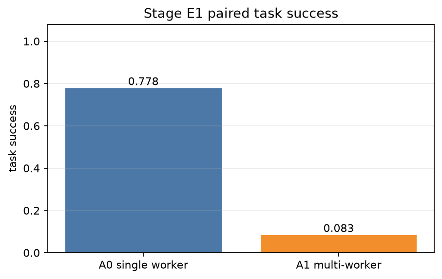
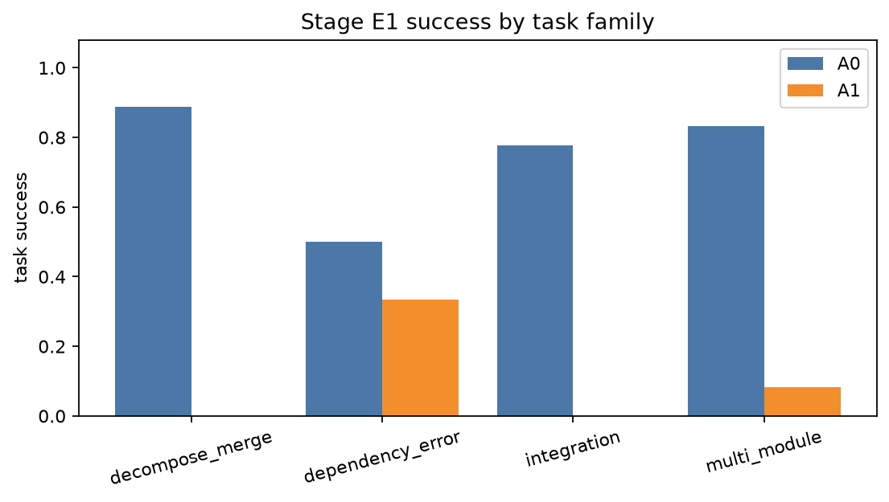
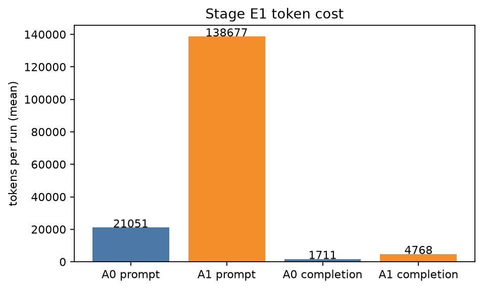

# Stage E1 - Paired Multi-Worker Collaboration Evaluation

## 1. Scope

Twelve new executable tasks (not copies of the five earlier multi-worker samples) were run in two
configurations with the same fixture, hidden oracle, model, temperature, sandbox image, tool
surface, 14-turn limit, 120k token budget, and 60-tool-call budget:

- **A0**: one scoped worker receives the complete goal.
- **A1**: two or three scoped workers execute a static dependency DAG; the same hidden oracle
  checks the final workspace.

Formal provenance: clean worktree at `50759ed`, round `e1-20261109T102030Z`.
72 paired executions = 12 tasks x 2 configurations x 3 repetitions.
All runs used real DeepSeek + real OpenSandbox; no scripted model or fake sandbox fallback.

A four-task smoke (`e1-20261109T101141Z`) ran first: A0 3/4, A1 1/4. It exposed two harness
issues before formal: the empty `e1-12` fixture could not be git-staged (fixed with a visible
README), and A1 was hitting the shared tool budget (raised from 40 to 60, still a controlled
limit). The smoke is not used for the formal rates.

| family | tasks | examples |
|---|---:|---|
| multi-module | 4 | config loader/merge/validate, report pipeline, RBAC, CLI |
| integration | 3 | parser+summary, KV API+client, formatter+exporter |
| decompose/merge | 3 | quantile/variance/summary, ETL stages, search stages |
| dependency/error | 2 | missing-input fallback, concurrent `state.json` conflict |

## 2. Main result

| variant | success | prompt tokens | completion tokens | turns | cache hit ratio | cost USD | p50 latency | tool calls |
|---|---:|---:|---:|---:|---:|---:|---:|---:|
| A0 single worker | **28/36 (77.8%)** | 757,828 | 61,598 | 257 | 0.9094 | 0.0987 | 37.5 s | 310 |
| A1 multi-worker | **3/36 (8.3%)** | 4,992,381 | 171,656 | 987 | 0.8839 | 0.4063 | 72.7 s | 1,075 |

A1 used **6.59x** prompt tokens, **2.79x** completion tokens, **4.12x** estimated cost,
**3.47x** tool calls, **3.84x** model turns, and **1.94x** median latency. Cost per successful
task was about **$0.0035** for A0 vs **$0.135** for A1.

One A0 run (`e1-04-cli`, repetition 0) was interrupted by an operator process kill during a
perceived hang; it has no failure class and is reported as an infrastructure interruption.
Excluding it from the A0 denominator gives **28/35 (80.0%)**.

### Paired comparison

- 36 matched pairs.
- A1-only successes: **2** (both on the concurrent-state conflict task).
- A0-only successes: **27**.
- both same: **7**.
- mean paired difference (A1 - A0): **-0.694**.
- descriptive 95% normal-approximation CI: **[-0.883, -0.506]**.

This is a small paired sample and is not presented as a population-level significance result.
The direction is consistent: adding static workers did not improve these tasks.

### By family

| family | A0 | A1 |
|---|---:|---:|
| multi-module | 10/12 | 1/12 |
| integration | 7/9 | 0/9 |
| decompose/merge | 8/9 | 0/9 |
| dependency/error | 3/6 | 2/6 |

The one genuine A1 advantage is the conflict task: independent A and B writes plus a merge worker
succeeded in **2/3** A1 repetitions, while A0 succeeded **0/3**. In every other family, A1 was
equal or worse.

## 3. Collaboration evidence

The formal run contains 96 worker executions and 36 dependency edges.

| evidence | value |
|---|---:|
| dependency edges | 36 |
| handoff complete edges | 21 (58.3%) |
| handoff consumed edges | 21 (58.3%) |
| transmitted upstream prefix bytes | 9,390 |
| worker executions | 96 |
| worker self-reported success | 48 |
| worker self-reported failure | 48 |
| all workers reported success but task failed | 8 runs |
| upstream success -> downstream failure edges | 6 |
| DAG nodes (mean) | 2.67 |
| critical path nodes (mean) | 1.67 |

Handoff completeness was checked from the downstream worker's actual first prompt, not from M7
lifecycle events. AnyCode truncates long prerequisite outputs (observed at a 500-character
projection cap); the byte count is the actual upstream prefix present, not the full producer
output. 15/36 edges did not transfer enough upstream output to count as complete; many of those
producers had already failed or produced no output.

Worker stop reasons:

| stop reason | count |
|---|---:|
| `success` | 48 |
| `max_turns` | 28 |
| `side_effect_unknown` | 18 |
| `doom_loop` | 2 |

The dominant A1 failure mode is not one worker crashing: it is **collective over-exploration and
premature self-termination**. Three workers each spend turns inspecting and self-testing; several
hit the 14-turn limit, and some stop after a benign non-zero test command. Worker self-reports are
not enough: eight runs had every worker report success while the hidden oracle failed.

## 4. Failure classes

| class | A0 | A1 |
|---|---:|---:|
| TASK_SUCCESS | 28 | 3 |
| ORACLE_FAILURE | 7 | 13 |
| BUDGET_EXCEEDED | 0 | 20 |
| infrastructure interruption | 1 | 0 |

A1 failures were mostly budget/coordination, not a single bad worker:

- 20/36 A1 runs exceeded the shared 120k token budget.
- One A1 run missed by only 1,372 tokens (`e1-01-config`, repetition 0, 121,372); the budget is
  a controlled limit, not a post-hoc pass criterion.
- The largest A1 overrun was 373,205 prompt+completion tokens on `e1-02-report` repetition 2.
- 13/36 A1 runs failed the hidden oracle without exceeding budget.
- 8 runs had all workers self-report success but fail the oracle; the final artifact, not the
  worker narrative, decided success.

A0 failures were ordinary task failures:

- `e1-12-conflict` 0/3: one worker did not produce both required JSON artifacts.
- `e1-02-report` repetition 1, `e1-06-kv` repetitions 1/2, `e1-10-search` repetition 1:
  hidden tests failed.
- `e1-04-cli` repetition 0: infrastructure interruption.

A1's two paired wins are both `e1-12-conflict` (repetitions 1 and 2), where independent A/B
writers plus a merge worker reconstructed both keys. This is real but narrow evidence that a
static DAG can help a conflict/merge task, not evidence of general multi-agent superiority.

## 5. What the worker DAG actually is

- AnyCode owns wave scheduling and dependency resolution.
- M2 scoped workers provide identities/profiles and task assignment.
- Dependencies are real `depends_on` edges; upstream results are injected into downstream prompts
  (truncated by AnyCode at the observed 500-character projection cap).
- All workers share one M5 sandbox and one project workspace.
- There is no dynamic supervisor, recursive delegation, worker-to-worker messaging, or
  worker-created task. A1 is a static DAG, not autonomous multi-agent planning.

## 6. Efficiency decomposition

A1's extra cost comes from the number of model turns (27.4 vs 7.1 per run), not from a larger
single prompt. Mean prompt tokens per run are 138,677 vs 21,051 because every worker reconstructs
its own context and often explores the full workspace. Cache hit ratio is slightly lower for A1
(0.884 vs 0.909), so the extra prompt volume is not offset by better reuse.

This is why the result is not "multi-worker is always bad". For a small, tightly scoped task, one
worker is the cheaper decomposition; for the conflict task, independent writers can be useful.
The deciding variable is whether parallel independent work creates information that a single
worker would have to simulate sequentially.

## 7. Failures worth reading

1. **`e1-12-conflict` A0 (all 3 reps)**: the single worker did not leave both `state.json` and
   `final.json`; A1's independent A/B writers plus merge succeeded twice. This is the clearest
   positive collaboration case.
2. **`e1-12-conflict` A1 rep0**: the opposite failure; "one or more workers produced no output",
   and the final artifacts were missing. Having workers is not sufficient; handoff/merge must
   complete.
3. **`e1-03-rbac` A1**: 190,529 tokens; two workers hit `max_turns` with 15 calls each, and the
   service worker reported success while the hidden policy test failed.
4. **`e1-02-report` A1 rep2**: 373,205 tokens; the largest overrun, triggered by repeated
   exploration and self-testing rather than a single expensive prompt.
5. **`e1-05-pairs` A1**: upstream parser output was truncated to the 500-character projection;
   the downstream summary still failed hidden tests. Handoff "existed" but was not sufficient.
6. **`e1-07-export` A1 (all 3 reps)**: all workers self-reported success but the integrated task
   failed; worker narratives cannot replace the final oracle.
7. **`e1-10-search` A0 rep1 / `e1-06-kv` A0 reps 1-2** show A0 also fails ordinary hidden tests;
   the comparison is not a rigged perfect baseline.

## 8. Conclusion

For this 12-task suite, a static multi-worker DAG **did not improve task completion quality**:
A1 succeeded 3/36 vs A0 28/36, at 4.1x cost and 1.9x median latency. The multi-worker path was
dominated by shared-budget exhaustion, turn-limit stops, and incomplete/truncated handoffs.
Worker self-reports were unreliable: 8 runs had all workers report success while the task failed.

The narrow positive result is the concurrent conflict/merge task, where independent writers helped.
That is a reason to use a static DAG for genuinely independent subproblems, not a reason to claim
dynamic multi-agent autonomy. AtlasOS currently has no dynamic supervisor; no result here should
be read as one.

## 9. Reproduction and artifacts

```bash
PYTHONPATH=src:. python -m experiments.evaluation.stage_e_rounds formal \
  --repetitions 3 --timeout 150 --max-turns 14
PYTHONPATH=src:. python -m experiments.evaluation.stage_e1_analysis
```

- [metrics.md](evaluation/stage-e1/metrics.md)
- [metrics.json](evaluation/stage-e1/metrics.json)
- 
- 
- 

Raw per-run directories remain under `experiments/results/stage-e1/e1-20261109T102030Z/`.

## 10. Boundaries

- Twelve small tasks, one model, three repetitions; results are model- and workload-specific.
- A1 is static DAG collaboration, not dynamic delegation.
- One A0 run was operator-interrupted; adjusted A0 is 28/35.
- Token budget and tool-call caps are shared controls; A1 exceeding them is a real efficiency
  failure, not a harness bug.
- Handoff byte counts are actual prefixes in prompts, not a claim that the full producer output
  was transferred.
- No automatic replay of unknown remote side effects was performed.
