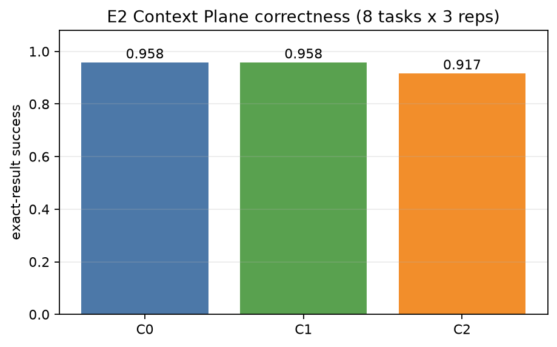
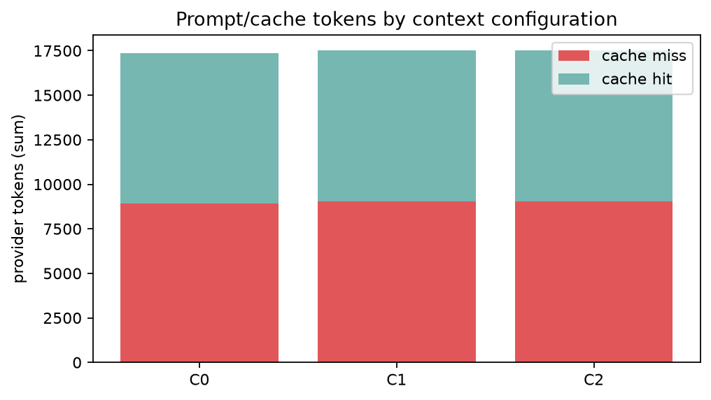
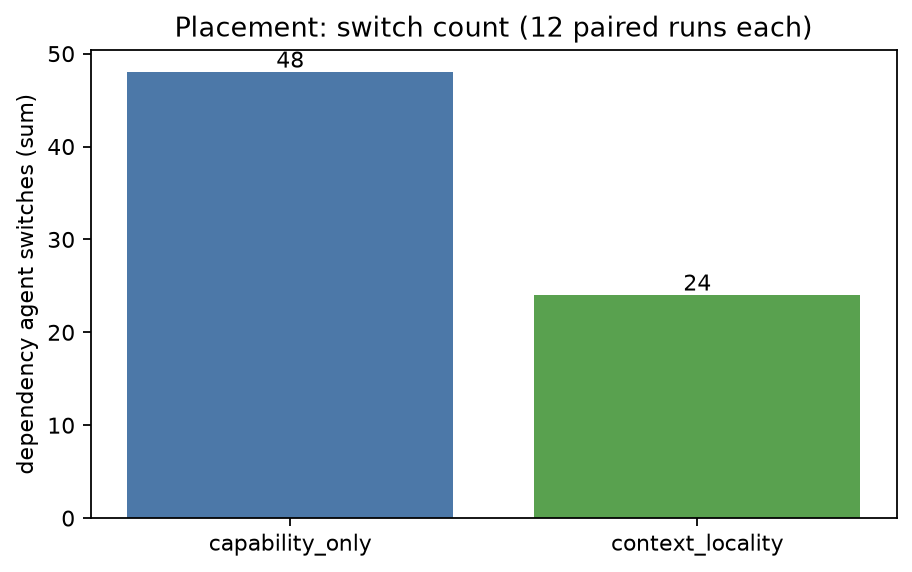

# Stage E2 - Context Plane Track A

## 1. Scope and execution path

This is **Track A**: the real V1 `AtlasRuntime` -> AnyCode -> DeepSeek multi-stage path. It does
**not** use the V2 coding adapter or OpenSandbox tools. Eight controlled 3-task workflows (root A,
root B, merge) were executed with real `deepseek-chat`, three repetitions per configuration.

Provenance: clean worktree at `85b3918`, round `e2-20261109T104850Z`.
Raw records: `experiments/results/stage-e2/e2-20261109T104850Z/`.

Configurations:

| ID | Context policy | Renderer | Transform | Placement |
|---|---|---|---|---|
| C0 | upstream_default | upstream_default | none | bypass |
| C1 | task_scoped | stable_deterministic | identity | bypass |
| C2 | task_scoped | stable_deterministic | ContextPilot dedup | bypass |
| P0 | C1 | stable_deterministic | identity | capability_only |
| P1 | C1 | stable_deterministic | identity | context_locality |

The merge task receives the real dependency outputs. Correctness is an exact `RESULT=...` token
match, not an LLM judge. Task profiles: clean, duplicate-heavy, conflicting-authority,
long-context, and multihop.

## 2. Results

### Context factor: C0 / C1 / C2

8 tasks x 3 repetitions = 24 runs each.

| configuration | correct | prompt tokens | completion | cache hit | cache miss | hit ratio | cost USD | p50 latency ms |
|---|---:|---:|---:|---:|---:|---:|---:|---:|
| C0 upstream | 23/24 | 17,367 | 678 | 8,448 | 8,919 | 0.4864 | 0.003540 | 2,695.5 |
| C1 task-scoped + stable + identity | 23/24 | 17,505 | 678 | 8,448 | 9,057 | 0.4826 | 0.003581 | 2,598.6 |
| C2 C1 + ContextPilot dedup | 22/24 | 17,505 | 678 | 8,448 | 9,057 | 0.4826 | 0.003581 | 2,838.6 |

Per-run means: 723.6 (C0), 729.4 (C1/C2) prompt tokens, i.e. **+0.8%** for the task-scoped/stable
path. The merge handoff prompt bytes are 8,469 (C0) vs 9,285 (C1/C2), **+9.6%**, because stable
rendering includes task-id/version wrappers around the same logical dependency content.

### Dedup

- Deduplicated calls: **0 / 72** inference calls in C1/C2.
- Removed blocks: **0**.
- Removed context characters: **0**.
- Prompt bytes C1 vs C2: identical (76,161).
- Transform CPU: 45.38 ms total across 24 C2 runs / 72 calls, about 0.63 ms/call.

ContextPilot dedup did not trigger on these short dependency outputs. This is a negative result,
not evidence that dedup is beneficial. It also means this run provides no evidence of dedup
removing a critical fact.

### Correctness failures

All failures were the `e2-06-conflict` task, where the merge chose the deprecated `V1-31` marker
instead of the authoritative `V2-32` marker for the first slot:

- C0: repetition 2
- C1: repetition 2
- C2: repetition 1 and repetition 2

The same wrong output appears in every configuration, so this is a model instruction-following
failure on the conflict rule, not a C0-vs-C1-vs-C2 context-loss signal. The other seven tasks
passed in all configurations and all repetitions.

### Cache

C0 executes first, then C1, then C2 for each task. C0 had a slightly higher hit ratio
(0.4864) than C1/C2 (0.4826); C1/C2 also had 138 more miss tokens. Because execution order and
provider cache state are uncontrolled, this is **not** a causal statement that the Context Plane
worsens caching. It does refute any claim that this run improved cache hits: there was no
improvement.

### Placement factor: P0 / P1

4 tasks x 3 repetitions = 12 runs each; C1 context, identity transform.

| configuration | correct | prompt tokens | switches | mean locality | p50 latency ms |
|---|---:|---:|---:|---:|---:|
| P0 capability_only | 12/12 | 6,021 | 48 | 0.000 | 4,473.1 |
| P1 context_locality | 12/12 | 6,021 | 24 | 0.667 | 4,176.1 |

Placement halved the measured **logical dependency agent switches** (48 -> 24) and raised
assignment locality (0 -> 0.667) with identical correctness, prompt tokens, completion tokens and
cost. Latency direction is not stable across rounds (an earlier 2-repetition round showed P1
slower; this one shows P1 faster), so no latency claim is made. This confirms the structural
placement effect, not a token or task-success benefit.

## 3. What this proves and does not prove

Proven:

- The task-scoped/stable path can preserve correctness on seven of eight controlled task types.
- Context-locality placement reduces logical handoff references by 50% in the 5-node DAG without
  changing tokens or success.
- The actual C1/C2 context path adds measurable prompt bytes (+1.1% total, +9.6% on the merge
  handoff) and a small transform cost.
- Dedup is not automatically effective on short dependency outputs; zero calls were deduped.

Not proven:

- No prompt-token reduction, cost reduction, cache-miss reduction, or correctness improvement.
- No evidence that dedup preserves or loses critical facts here, because it did not run.
- No causal cache claim.
- No coding-agent context benefit: the V2 coding adapter does not use the V1 prompt/context path.

## 4. Track B - V2 coding integration feasibility

The coding adapter (`experiments/evaluation/runner.py`) constructs `AtlasContextEngine` with a
`tool_runtime` but **no** `prompt_builder`. `AtlasRuntime._build_atlas_prompt()` is coupled to an
`AtlasWorkflow`, a task-scoped `ContextStore`, placement specs, and Atlas task IDs. Reusing it for
arbitrary coding sessions would require a new, explicit context projection from coding tasks and
files plus a prompt-builder seam in the session composition.

That is a runtime integration change, not an evaluation change. It was not implemented in this
stage. Therefore this report makes **no coding-benchmark context-benefit claim**. The multi-worker
coding results in Stage E1 are reported separately and do not use this Context Plane path.

## 5. Reproduction

```bash
PYTHONPATH=src:. python -m experiments.evaluation.stage_e2_rounds all \
  --repetitions 3 --timeout 240 --call-timeout 45
PYTHONPATH=src:. python -m experiments.evaluation.stage_e2_analysis
```

Metrics, failures and figures:

- [metrics.md](evaluation/stage-e2/metrics.md)
- [metrics.json](evaluation/stage-e2/metrics.json)
- 
- 
- 

## 6. Boundaries

- Eight small controlled workflows, one model, three repetitions. They exercise context
  projection, not long-horizon production coding.
- Conflict failure is model instruction-following, not proof of context corruption.
- Execution order is fixed C0 -> C1 -> C2; provider cache is warm-prone and uncontrolled.
- Track A is a real LLM multi-stage context evaluation, not a coding-agent benchmark.
